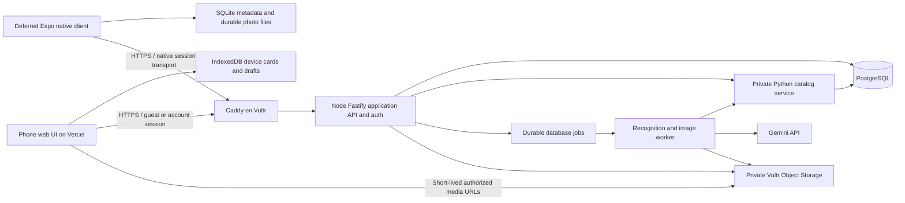

# TrainDex — Product, Backend, Accounts, and Storage Specification

**Project:** Two-person SBUHacks MVP

**Revision:** 2026-10-25 — Mobile-browser MVP; Expo deferred; optional accounts

**Status:** Implementation plan; distinguishes existing code from proposed work  
**Frontend:** [Design specification](frontend-spec.md)

## 1. Product decisions

TrainDex opens directly into a camera. A user photographs the front or rear of a subway train, the app reads its sign and compares its appearance with the SVG reference library, and generates a personal virtual card from that encounter. OCR remains in the intended pipeline; Gemini makes the final appearance comparison and may return an uncertain result.

**Flow:** Capture → Preview/crop → Recognize → Review card → Save choice → Reveal → Collection.

- No sign-in gate before capture or online recognition.
- Hackathon MVP Save uses **Save on this device**. Hide simulated account/import controls in the real demo. Sign-in and cloud saving become available only if the optional account milestone is completed.
- Each deliberately saved encounter creates a separate card. Retrying the same save does not.
- Group cards by subway route. Uncollected supported routes show question-mark placeholders; there is no public reference-catalog screen or pre-generated card inventory.
- Card theme: original GBA-era pixel-art interface with foil accents. User photographs remain clear. Templates compose photos and attributes; generated art is not required for each card.
- No rarity tiers, editions, collectible serial numbers, actual trading, battles, public sharing, or public reference submissions in current scope.
- Photos/cards are private. The backend reference library supports recognition; it is not the user's collection.
- Live car-to-route mappings and GTFS trip matching are not required.

Labels: **Existing** means found in repository source, not confirmed deployed. **Proposed default** is the recommended build plan. **Open** requires a later product/deployment choice. No infrastructure has been provisioned by this specification update.

### Hackathon scope and release gates

**Required:** one real physical phone completes photo selection/capture → online recognition → honest review → durable device save → collection → reopen full photo after refresh/app restart. The primary target is the existing web UI in a mobile browser. Deploy a shared URL/QR, rehearse on a physical phone and judging network, and verify browser refresh/full-photo recovery. Expo is deferred.

**Optional after this works:** Google accounts/cloud saves, explicit import, then email/password. Do not let account creation, TestFlight, App Store release, Android packaging, or polishing both clients block the first working phone demo. Accounts may be omitted entirely from the hackathon submission.

**Agreed client choice:** prioritize optimizing the existing React DOM/Vite UI for mobile browsers. You own responsive/touch UI, browser camera/photo selection, IndexedDB/device saving and client API wiring. Your friend owns the complete backend including recognition, storage, database and deployment. Expo/React Native is deferred; no native app is required for this MVP. Keep API/data interfaces reusable without building a second client now.

## 2. Card fields and identity

| Field | Rule |
|---|---|
| Route designation | Visible A, C, E, 7, etc.; text identifier independent of color |
| Rollsign variant | Stable matching SVG/sign ID; retain actual shape, color, and display style |
| Train model | Optional recognized R160/R179/R211/etc.; Unknown is valid |
| Photograph | Personal encounter image, with full-photo viewing independent of the recognition crop |
| Capture timestamp | EXIF when usable; shutter-time or explicitly estimated upload-time fallback |
| Station | Optional coarse user-selected station; no required GPS |
| First collected date | First save/unlock for this user's route + sign variant |
| Encounter count | Saved encounters for the same route + sign variant, across train models |

A different model or photograph distinguishes a personal card without creating a new SVG variant. Do not infer a train model solely from an SVG style-family label such as R62A. A reference may be reconstructed artwork rather than a photographed physical sign; preserve that provenance. Angle, lighting, and blur alone do not establish a new sign variant.

**Proposed default:** Route progress counts supported routes with at least one matched saved card. Optional unique-variant count is separate from total cards. Do not imply a finite total of all possible personal cards. First-collected date derives from earliest remaining saved encounter, not an old photo's EXIF timestamp; whether unlocks persist after deleting every related card remains open.

### Time and image metadata

Read EXIF before re-encoding. Preserve capture-time source (`exif | shutter | estimated | user | unknown`), precision, original local time, and UTC offset/timezone if available. EXIF without an offset is timezone-uncertain, not automatically UTC. Fresh in-app photos fall back to shutter time. Uploaded photos without usable time suggest selection time labeled Estimated, with edit/Unknown options. Keep server upload/save timestamps separately. Strip unnecessary EXIF from persisted derivatives, and do not automatically use EXIF GPS as station data.

## 3. Current code and target architecture

### Existing repository implementation

- `apps/api/`: Node.js/TypeScript + Fastify, multipart image upload, Gemini identification, route definitions, and a small HTML test page.
- `app/`: Python/FastAPI + SQLAlchemy/Alembic reference catalog and metadata matching endpoints.
- PostgreSQL is configured through Compose. Existing catalog migrations/imports must be preserved.
- The Node recognition path currently calls Gemini directly and can load examples from a folder. It does not yet implement the complete OCR/retrieval pipeline, accounts, durable cards, cloud photo storage, or local collection persistence.
- `apps/web/` contains the React DOM/Vite/Tailwind interactive prototype, separate from the API test page. Its account/recognition/save states are simulated and local persistence is not wired. There is no native Expo client in this checkout. Deployment status is not established by source code.

### Proposed default architecture

- **Primary demo frontend:** existing `apps/web/` React/TypeScript/Vite/Tailwind website hosted on Vercel and optimized for phone browsers. You own responsive/touch layout, camera/picker/crop, IndexedDB persistence, API integration and real-phone rehearsal. No app installation is required; PWA installation is optional.
- **Deferred native client:** a future proposed `apps/mobile/` could reuse API types and pure data logic, but requires native screens/navigation, camera and SQLite/files adapters. Do not start an Expo port during the browser MVP work.
- **Vultr compute:** One Ubuntu VPS initially, running Caddy, Node API/auth, Python catalog service, PostgreSQL, and worker via Compose.
- **Vultr Object Storage:** Durable private photos, crops, and thumbnails. This is a separate cloud storage resource from VPS disk; use an S3-compatible client from Node.
- **PostgreSQL:** Accounts/sessions, ownership, card metadata, reference catalog, job state, and object keys. Do not put photo blobs in ordinary card rows.
- **Reference assets:** Keep the curated SVG seed versioned and available locally to the catalog/worker; optionally mirror immutable files in object storage. Rasterize trusted SVG references before sending to a vision model where necessary. Existing reference identity/provenance stays intact.
- Node is the public application boundary for web and native clients. Python remains internal for the existing catalog; avoid a rewrite during the hackathon. Both use controlled schema ownership, not competing migrations of the same tables.
- Gemini is an external recognition service. Reference images must be explicitly selected and supplied; it cannot inspect local storage automatically.

Node handles network I/O well, but scalability comes from bounded work, shared storage, queues, indexes, and provider budgets. Move CPU-heavy decoding/resizing/rasterization off the API event loop into workers. Python catalog code does not prevent scaling.

## 4. Optional account creation and authentication plan

**Release gate:** no accounts are required for the hackathon MVP. Implement this section only after the phone demo and sharing gates pass. Google is the first optional provider; email/password is later scope.

**Proposed default:** Better Auth integrated with Fastify, persisted in PostgreSQL, with **Continue with Google** as the first authentication method. First successful Google sign-in creates an account; returning sign-in restores access. This avoids custom password handling and an email-delivery dependency for the first account release. Email/password can be added later with verification, password-reset delivery, and abuse controls; it is not silently assumed available.

1. Guest begins capturing without an account prompt. Preserve the current photo/card draft in the platform device repository before redirecting to authentication.
2. On Save, offer Sign in/Create account (both can lead to Continue with Google) or device saving.
3. The auth library handles OAuth state/PKCE as supported, callback verification, provider identity, and sessions. Use its supported integration rather than hand-building OAuth.
4. On callback, resolve the user from the verified session and resume the pending card's save. Cancellation/error returns to the card with device saving still available.
5. Show **Saved to your account** only after durable photo processing and card commit succeed. Sign-in alone is not a save.
6. Sign-out revokes the session and clears account-specific cached data from the browser; separately saved guest cards stay in their own device collection.

### Later email/password extension

Better Auth can support email/password alongside Google. Use its generated credential schema and supported salted password hashing/verification; never store plaintext or reversibly encrypted passwords, or create a separate hand-written password system. Google-only identities have no local password. Add email ownership verification, transactional email delivery, expiring single-use password recovery, password-change/session-revocation flows, rate limits and non-enumerating responses. Test verified account linking so matching unverified email strings cannot take over a collection. This is a separate release gate, not merely another sign-in button.

### Session/deployment contract

The cookie/domain rules below apply to the web client.

- Use Secure/HttpOnly session cookies with library-supported settings; never store long-lived auth tokens in localStorage. Persist sessions in PostgreSQL so restarts/multiple API instances work.
- Recommended domains: frontend `app.<owned-domain>` on Vercel and API `api.<owned-domain>` on Vultr. Configure exact trusted origins, credentialed CORS, CSRF/Origin checks, and explicit OAuth callbacks. Use a host-only API cookie when possible.
- Verify HTTPS cookie/OAuth behavior on actual mobile browsers. If using the Vercel default domain, implement/test a same-origin API proxy or obtain the shared domain before relying on cross-site cookies.
- Use the library's generated auth schema and supported version; don't invent incompatible session/token formats. Never auto-link identities merely because an unverified email string matches.
- Google OAuth credentials, Gemini key, auth secret, DB credentials, and S3 credentials are server secrets. Limit OAuth scopes to identity needs.
- Native account auth needs the supported Expo/native integration, secure token storage and tested redirects/deep links; do not assume browser cookies/OAuth callbacks work unchanged in Expo Go. Defer this until the chosen runtime is proven. Registration/provider configuration and deployment are future implementation steps, not actions performed by this document.

## 5. Guest recognition and device-local saving

### Anonymous recognition session

A guest can use the network recognition API without creating an account. For web, issue an opaque, short-lived HttpOnly guest-session cookie; store its hash and expiry. For native, define an explicit opaque guest bearer transport with the same ownership/expiry rules, store the token in SecureStore and send it only over HTTPS in the Authorization header. Do not put it in URLs/logs or treat it as a permanent account. Test browser cookie and native bearer paths separately; never weaken owner checks for mobile. Guest sessions own temporary uploads/jobs/results and are not recoverable user accounts. Require that session on polling/read/delete requests; do not expose unguessable job IDs as the only access check.

**Proposed starting controls:** guest session lifetime 24 hours, completed guest-upload cleanup within 24 hours, small per-session/IP rate limits plus a global Gemini spend/concurrency limit. These are configurable operational defaults, not guarantees against quota evasion. Deny excess requests with actionable retry messaging. Avoid creating unlimited paid AI work before authentication.

### Device save

If native is implemented later, it must meet the same durable-save contract with SQLite metadata and app-document photo files: copy picker/cache files before confirming Save, publish the metadata only after the files are ready, and recover/clean up partial writes. SQLite and filesystem writes are not one atomic transaction. Clearing browser data or uninstalling a native app can remove local collections; there is no cross-device recovery without accounts/export.

- IndexedDB stores stable encounter UUID, photo Blob, crop/thumbnail, matched reference display asset, metadata, recognition receipt, and local save state. A preview URL or metadata-only localStorage record is not a photo save.
- Web: commit photo and metadata in an IndexedDB transaction; show Saved on this device only on success. Handle quota/storage-denied errors without discarding the current preview.
- Web: local cards/photos survive ordinary refresh when browser storage remains available; clearing site data or storage eviction can remove them. Offer persistent-storage permission where supported, without promising browser permanence.
- Local collection works without an account. Keeping a card locally does not mean it never left the device: online recognition uploads a temporary image/crop to the backend/Gemini.
- If offline before recognition, save an unrecognized photo draft. If recognition is already complete, save the resulting card locally without connectivity. Cloud saves require connectivity.
- Preserve a receipt binding the server's recognition result to photo checksum, encounter, catalog/model versions, and outcome. Use a signed, verifiable receipt or server record; do not trust edited browser JSON during later import. Never include private reference URLs or secrets in it.

## 6. Cloud photo storage and save lifecycle

**Proposed default:** private Vultr Object Storage from the first cloud-saving release. VPS disk is temporary processing space and local reference cache, not the only durable copy of user photos. A filesystem adapter is acceptable for local development with an explicit configuration switch.

### Stored media

- Full-frame normalized photograph, preserving enough resolution for full-photo viewing (proposed maximum long edge 2560 px; tune after image tests).
- Separate sign crop for recognition and optional model analysis using full-frame context.
- Small collection thumbnail (proposed long edge 480 px).
- Card render export is unnecessary initially; render the foil template client-side from data and image assets.
- Validate incoming file type by decoding, cap bytes and decoded pixels, normalize orientation, strip extra EXIF, and re-encode. Initial limits: 8 MB per uploaded image and 24 megapixels decoded, configurable. Test HEIC handling; offer conversion/reselection if unsupported.
- Keep source upload bytes only until validated derivatives are ready. “Full photo” means full framing, not a promise to preserve the original camera file byte-for-byte.

### Initial upload design: API-mediated streaming

Start with one bounded multipart upload to Node for a guest/account owner. Stream to temporary/quarantine storage rather than buffer unlimited photos in API memory. Worker validates, decodes, generates immutable derivatives, stores them privately, and marks assets Ready. Nothing unvalidated is served as an image.

For an account Save:

1. Obtain the authenticated user and an idempotent encounter/save ID; verify ownership of the temporary capture or claim it through the current guest session.
2. Ensure the required full-photo and thumbnail objects exist, are validated, and are marked Ready. Failed uploads remain retryable and do not create a successful card.
3. In a DB transaction, create/link the account capture and card, attach recognition evidence and assets, and mark them retained. One card per encounter; same request with different content is a conflict.
4. Return the persisted card. The UI then reveals it.
5. Garbage collection removes abandoned staged media and unreferenced objects after a grace period. Object storage and PostgreSQL do not share a transaction: DB state, immutable object keys, and retryable cleanup handle partial failure.

### Private delivery and deletion

API checks session ownership before issuing short-lived presigned GET URLs (proposed 5 minutes), or proxies the image if immediate access revocation is required. URL holders can read until expiry; deletion/sign-out prevents new URLs but does not magically revoke an already issued URL. Never log signed URLs. Keep private media out of public service-worker caches/CDNs.

Use generated asset UUID keys, immutable final objects, no public-read bucket, and no bucket listing exposed to clients. Restrict service credentials using capabilities supported by the deployed storage service. Keep reference/public assets separate from private user images.

Delete card visibility immediately in the DB, then enqueue media deletion when no other owned record references it. Account deletion revokes sessions and removes owned cards/captures through a retryable cleanup job. Backups have a documented expiry rather than a promise of immediate erasure from every backup.

### Later optimization: direct signed uploads

When API upload bandwidth becomes a bottleneck, issue short-lived presigned PUT URLs for fresh quarantine keys, configure exact-origin storage CORS, and require an explicit upload-complete endpoint. Verify object size/checksum and decode before copying/re-encoding to a new immutable final key. Do not sign the final served key: a reusable upload URL could overwrite it after validation. Reject/delete oversized objects even if uploaded successfully; validate provider support for any pre-upload size constraints. Run periodic abandoned-upload cleanup.

Vultr supports presigned URLs/CORS/lifecycle operations, but its documented compatibility matrix does not support bucket notifications or replication. Use explicit completion calls and worker polling; do not assume S3 event-trigger behavior or automatic cross-region replication.

## 7. Import device cards into an account

**Proposed default:** after successful sign-in, offer **Add device cards to my account** with the number of cards. Import is explicit, not a silent upload of every local photograph.

- Preserve original encounter UUIDs. Process imports with bounded concurrency and visible per-card progress.
- Upload each local photo if its temporary cloud copy has expired; verify checksum against a signed recognition receipt. If the receipt is missing/invalid or classification needs rechecking, queue recognition and show Checking rather than trusting local attributes.
- A valid historical receipt records its catalog version; retired references remain resolvable or explicitly unmatched. Do not fabricate a fresh match from an obsolete ID.
- Upsert by `(user_id, encounter_uuid)` and reject changed-content reuse. Retrying, refreshing, or resuming must not multiply cards or encounter counts.
- Mark each local record with destination account and cloud card ID only after success. Keep local data until the user chooses removal; failed items remain locally usable and retryable.
- Render one encounter when both local and account copies exist, using the mapping. Never delete the local copy merely because authentication succeeded.
- Account switching must not automatically import another person's local/device cards; ask again for an explicit import into the selected account.

## 8. Recognition and reference workflow

1. Capture/crop; extract usable timestamp metadata; retain full photo locally.
2. OCR supplies text hypotheses and tool scores. For the demo, run OCR in the server worker so both web and Expo can use it without a custom native module; browser OCR is an optional adapter/optimization. It does not certify a sign appearance.
3. Guest/account API creates a temporary capture and durable job.
4. Worker queries the existing Python catalog for candidates using route hypotheses and visible attributes. Weak OCR broadens retrieval. Metadata scores are heuristic, not probabilities.
5. Rasterize selected trusted SVG references when required; send a bounded candidate set with stable IDs plus query photo/crop to Gemini. Include full-frame context only when needed for optional train model.
6. Gemini chooses a supplied variant or abstains, reporting visible text/shape/style, model or Unknown, and limitations. Validate output enums and ensure returned variant IDs were supplied. A novel photo is not automatically a new reference design.
7. Return review data, receipt, and first/repeat encounter information appropriate to the current collection. Device collection counts are computed locally; account counts come from the server.
8. Save locally or to an account through sections 5–7. Unknown model never blocks saving.

Suggested normalized outcomes: `matched | unmatched | uncertain | unusable | not_a_sign`; job state is `queued | processing | complete | failed | cancelled`. Keep recognition state separate from storage state (`unsaved | saved_device | saving_account | saved_account | save_failed`).

**Proposed unresolved policy:** a clear route with unmatched variant may be saved with variant Unknown, excluded from variant counts; illegible/no-sign photos remain drafts. This is still a product choice, not an agreed moderation system. No automatic reference promotion or public submission. Correcting a match preserves the personal photo/encounter and recalculates grouping/counts.

Keep references versioned, attributed, and immutable per published version. Preserve reconstruction-versus-photograph distinctions and source licenses. Current SVG specimen membership is bounded reference coverage, not a census of every manufactured sign. Evaluate on held-out phone photographs rather than on the same SVG examples used for matching.

## 9. Suggested database additions and migration ownership

Preserve existing Python-managed catalog tables (`sign_designs`, `routes`, `reference_images`, `sources`, `specimen_sets`, `specimen_entries`, etc.). The app uses their existing stable IDs instead of creating a second incompatible sign catalog. Suggested application tables below are new work; no migration is applied by this spec.

**Migration rule:** Alembic continues owning existing catalog tables. Put new application/auth tables in designated namespaces or explicit table mappings. Auth uses its generated schema; adopt generated changes into one migration process for that namespace. Node and Python must never independently auto-create/alter the same tables. Use read-only catalog access from the app boundary where feasible.

| Table / group | Suggested fields and purpose |
|---|---|
| Auth library tables | User, provider account, session, verification tables as generated by the pinned library; application FKs use its actual user ID type |
| `app_guest_sessions` | `id`, `token_hash`, `expires_at`, `created_at`, quota counters/reference; temporary recognition ownership |
| `app_media_assets` | `id`, `user_id?`, `guest_session_id?`, `bucket`, `object_key` unique, `kind`, `state`, MIME, size, dimensions, checksum, parent/crop, `expires_at?`, timestamps |
| `app_uploads` | `id`, owner, request UUID/fingerprint, staging asset, expected size/checksum, `status`, `expires_at`; upload lifecycle |
| `app_captures` | `id`, owner, `encounter_uuid`, photo/crop asset IDs, capture time + local-time/zone uncertainty/source, station?, upload time, processing state |
| `app_recognition_jobs` | `id`, capture, state, attempt count, next attempt, lease/heartbeat, error code, timestamps |
| `app_recognition_runs` | `id`, capture, catalog/pipeline/model/prompt versions, outcome, route/sign IDs?, train model?, confidence/evidence/limitations, photo checksum, immutable result |
| `app_recognition_candidates` | Run ID + reference ID, rank/score, whether supplied to Gemini; exact comparison evidence |
| `app_cards` | `id`, `user_id`, capture ID unique, encounter UUID, recognition run ID?, route/sign IDs?, model?, `match_status`, template version, metadata snapshot, saved/updated/deleted times |
| `app_import_items` | `user_id`, encounter UUID unique per user, card ID?, state, error/retry information; resumable device import |
| `app_cleanup_jobs` | Asset/capture/account target, action, state, retries, next attempt; deletion/orphan cleanup |
| `app_change_events` | Actor, card/capture, correction type, before/after, time; recognition changes without erasing old evidence |

### Constraints

- Temporary captures/assets have exactly one owner: user or guest session. Cards require an account owner; device-only cards live in the platform device repository, not a permanent server guest collection.
- Owner-aware foreign keys or transactional checks enforce capture/asset/card ownership. Caller-supplied user IDs are ignored.
- Claiming a guest capture requires both current guest-session proof and authenticated destination account; transfer all dependent assets atomically and reject repeat claims to another account.
- Unique `(user_id, encounter_uuid)` and unique card per capture. Guest captures also enforce `(guest_session_id, encounter_uuid)` uniqueness. UUIDs are idempotency keys, not access credentials.
- Card save requires validated ready media. Hashes support integrity/dedup checks but do not confer ownership; identical photos from different users remain isolated.
- Reference IDs may be null for unmatched cards. Retain immutable recognition evidence when a current card link changes.
- Index cards by owner/route/save time and owner/sign ID; index jobs by state/next attempt/lease; assets by state/expiry; imports by owner/encounter.
- Derive collection grouping/counts from saved cards initially. Add materialized summaries only if measured query cost justifies them.

## 10. Proposed API surface

The [guest capture API contract v1](docs/contracts/guest-capture-v1.md) defines exact upload fields, examples, guest transport, crop/time rules, polling/results and errors. Processing retry may create a new run/crop on the same capture/encounter; the source image remains immutable and receipts bind the selected run. Upload idempotency remains tied to the original image/metadata fingerprint. Cancellation is idempotent and preserves a terminal completion if completion won the race. These are proposed implementation semantics, not existing endpoint support.

The existing `/v1/identify` remains a development entry point during migration; replace its synchronous-only flow with jobs without misrepresenting existing endpoint support. MVP endpoints are guest-session, captures/status/retry/cancel, media, supported routes and health/readiness. Account/card/import endpoints below are deferred. Device-local card operations do not require server card rows.

| Endpoint | Purpose / access |
|---|---|
| `/api/auth/*` | Optional accounts: library-managed Google sign-in/callback/session/logout; email/password later |
| `POST /v1/guest-session` | Establish rate-limited temporary recognition session |
| `GET /v1/me` | Account state without forcing login |
| `POST /v1/captures` | Multipart upload + encounter UUID; guest or user; return capture/job IDs |
| `GET /v1/captures/:id` | Owner-only processing/result |
| `POST /v1/captures/:id/retry` | Bounded retry; preserve encounter identity |
| `POST /v1/captures/:id/cancel` | Owner-only cancellation; late completion cannot publish a usable result |
| `POST /v1/captures/:id/claim` | Guest-session proof + account session; atomic ownership transfer |
| `POST /v1/cards` | Account save of owned, ready capture; idempotent |
| `GET /v1/cards`, `GET /v1/cards/:id` | Private account cards, route filters, cursor pagination |
| `PATCH /v1/cards/:id` | Owner capture-time/station corrections; no arbitrary model confidence/reference promotion |
| `DELETE /v1/cards/:id` | Hide card and schedule unused-media cleanup |
| `POST /v1/imports`, `GET /v1/imports/:id` | Explicit resumable device import; validate each photo/result |
| `GET /v1/media/:id` | Owner check then short-lived URL or proxy response |
| `GET /v1/collection` | Route counts, card counts, route + variant encounters; no global card denominator |
| `GET /v1/routes`, `GET /v1/stations` | Supported placeholders and optional coarse location |
| `DELETE /v1/me` | Reauthenticated account deletion and cleanup |
| `/healthz`, `/readyz` | Process and required DB/schema readiness |

Add direct-upload initiation/completion endpoints only when implementing section 6's optimization. Backend reference routes can remain internal; no public catalog screen is required. Errors use a stable envelope with code, message, and retryability. The UI never treats a failed network response as an empty collection or successful save.

## 11. Deployment, backups, and privacy

Start on one Vultr VPS with PostgreSQL and internal services; expose only Caddy HTTPS and restricted administration. Persist DB and Caddy state. Keep object storage in a suitable nearby region to reduce transfer latency; select actual region/tier against cost and availability before provisioning. Frontend remains on Vercel.

Secrets stay outside Git. Environment examples include public app/API origins, auth base URL/secret, Google OAuth credentials, DB URLs, Gemini model/key, S3 endpoint/region/bucket/credentials, and upload/queue/quota settings without secret values.

Proposed operations defaults:

- Guest uploads and abandoned drafts: 24-hour server retention; device-local copies are independent. Cleanup coordinates with active jobs and in-flight saves.
- Account media: retain while attached to saved cards; retry failed deletes. Delete unneeded originals after normalization.
- Encrypted daily DB backups outside the VPS with a proposed 7-day rolling retention; restore drill before relying on the deployment.
- Object versioning is protection against overwrites/deletion, not a complete independent backup. Configure noncurrent-version expiry and an explicit independent backup/export process for retained media; verify restore by checksum and DB manifest. Do not assume Vultr automatic bucket replication.
- Proposed initial recovery objective: up to 24 hours of DB changes lost in a disaster; recovery time must be measured in a restore drill, not promised.
- Monitor disk space, object bytes, failed uploads/deletions, queue age, API error/latency, DB connections, and Gemini usage. Do not log private photos, session tokens, signed URLs, or detailed travel histories.
- Disclose temporary backend/Google image processing even for local-save guests. No photo is automatically added to the reference library.

### Phone access and sharing plan

The Vultr backend is independent of the client runtime: a phone browser, Expo Go app, or installed Android app calls the same public HTTPS Fastify API. `localhost` on a phone points to that phone, not the VPS. Keep Gemini/database/storage credentials exclusively on the server; the public API base URL may be client configuration.

| Delivery path | What must be hosted/running | Hackathon use |
| --- | --- | --- |
| Existing phone website | Built frontend on Vercel + API/worker/catalog/database on Vultr | Primary demo and shared URL/QR; no developer laptop needed after deployment. |
| Expo Go | Separate native client + supported JS bundle delivery/development server + hosted API | Deferred native testing option; not needed for the browser MVP. |
| Android preview APK | EAS preview/internal build with bundled JS + hosted API | Optional install link; verify cold launch without Metro or a laptop. |
| iOS standalone app | Apple signing/provisioning and an appropriate distribution route | TestFlight/App Store/ad hoc distribution is outside the required MVP. |

Expo Go contains a fixed set of native libraries; pin a compatible SDK and prove camera, picker, storage, image rendering and networking on a real device before porting all screens. A hosted API does not host the Expo JavaScript bundle. A remote development server/tunnel can remove the laptop dependency for a supervised test, but is still a running development service, not a standalone release. Do not promise EAS Update as arbitrary Expo Go distribution without verifying the current supported workflow.

Current Expo documentation checked October 25, 2026 says physical iOS Expo Go development-server access requires CLI and Expo Go signed in to the same Expo account. Do not ask judges to share the team's credentials; rehearse on a team-owned phone and provide the web URL for judges' own iPhones. If Expo access fails, use the proven web demo rather than blocking the showcase.

## 12. Scaling and cost plan

### Stage 1 — hackathon / small pilot

One API instance, one worker with low concurrency, existing internal catalog service, PostgreSQL on the VPS, private object storage. Start with a Postgres-backed job queue using atomic claims/leases; retry/backoff and maximum attempts prevent infinite provider calls. Queue and save correctness matter more than adding services.

### Stage 2 — measured growth

| Observed pressure | Next change |
|---|---|
| Upload traffic saturates API bandwidth | Direct signed quarantine uploads with completion validation |
| Recognition jobs wait too long | Separate worker compute, increase bounded concurrency within Gemini quotas |
| Image transforms block requests | Dedicated image worker/process; bounded memory/pixels |
| API latency or availability suffers | Multiple stateless Node instances behind a load balancer; shared DB sessions, job state, storage, and distributed rate limits |
| DB CPU/connections/IO bottleneck | Index/query review, pool sizing across instances, then separate or managed PostgreSQL on Vultr |
| Large collections load slowly | Cursor pagination, thumbnails, lazy loading; account-scoped cache |
| Reference lookup dominates | Cache immutable references; improve candidate retrieval after held-out measurement |
| Provider quota/spend reached | Admission limits, backpressure, retries for retryable responses, clear wait states; more Node servers do not increase Gemini quota |

No Kubernetes, distributed microservice split, or vector database is needed by default. If job coordination outgrows the database queue, evaluate a dedicated queue based on actual throughput/recovery needs.

### Capacity estimate, not a provider quote

Assume each encounter retains a 1.5 MB normalized full photo + 0.2 MB crop + 0.1 MB thumbnail = **1.8 MB**. At 1,000 users × 50 cards, that is about **90 GB** before versions/backups; 10,000 users × 50 cards is about **900 GB**. Real sizes must be measured. Budget separately for VPS, object-storage minimum tier, storage/transfer/request charges, DB backups, and Gemini calls. Image resizing and candidate-count limits affect both cost and latency.

Set configurable account storage quotas (proposed pilot: 100 cards or 250 MB, whichever comes first), guest rate limits, and global daily AI spend ceilings. Revisit these against the chosen Vultr plan and real usage; no current price is assumed here.

## 13. Implementation sequence and acceptance

1. **D0 — phone browser and contract:** A (you) checks the existing UI on a real phone; B (friend) exposes HTTPS API health/request fixtures. Agree guest session/upload/crop/time/result/error fields before independent wiring.
2. **G1 — local path + hosted foundation in parallel:** A owns mobile-browser UI, camera/picker and durable IndexedDB photos/cards; B owns Vultr deployment, guest sessions, bounded upload/validation, database jobs, cleanup and staging HTTPS.
3. **G2 — real guest vertical slice:** B owns OCR/catalog/Gemini, workers/media/receipts; A wires the browser review/save journey. Complete photo → recognize → review → device save → refresh → reopen full photo on a physical phone.
4. **D1 — judge-ready sharing:** deploy the website and hosted backend, share a URL/QR, and rehearse phone/network, permissions, offline/error recovery and spend limits. No Metro, Expo Go, APK or TestFlight is required.
5. **A1/A2 — only with spare time:** Google accounts/cloud cards, then explicit device import. Include ownership, privacy, deletion and failure tests before exposing account features.
6. **A3 — later:** email/password plus verification, recovery, delivery, abuse controls and safe account linking. Native account integration is separately tested if native ships.

**Two-person ownership:** A = you, mobile-browser client/UI, IndexedDB device repository and API adapters. B = friend, all backend including OCR/catalog/Gemini, API, workers, database/migrations, private media and deployment. B owns `apps/api/**`, Python/catalog/migrations and infrastructure; A owns `apps/web/**`. B drafts the shared API contract and fixtures; A reviews them and builds against explicit fixtures while B tests the server independently. Layout changes should not affect backend internals; crop/image conventions, guest credentials and result/retry semantics require joint agreement. Expo remains deferred. See [backend implementation TODO](backend-implementation-todo.md).

The following checks are phase-specific: guest/device/isolation/limits checks block the demo; account, cloud-save and import checks apply only if those optional features ship.

Acceptance checks:

- Deferred native release (only if implemented later): camera/picker, orientation/crop, safe areas, navigation, accessible touch controls and photo/metadata recovery after app restart work on a physical phone. Prove runtime/bundle access separately from API availability.
- Mobile browser release: phone-sized layouts, safe areas, scrolling above bottom navigation, readable text, touch targets, keyboard/search behavior, camera permission fallback and reduced motion work on actual phones. Browser width controls are useful previews, not device validation.

- Guest launch reaches camera; recognition works without account creation. Local save survives refresh with full photo.
- Both sign-in cancellation and failed cloud save preserve the local card. Login resumes the intended save.
- A saved account card and photo load on a second authenticated browser.
- Repeated saves/import retries/worker restarts create one card per encounter; distinct encounters remain separate within a route.
- Route + variant counts include different train models; Unknown model/time/station do not invent data or block otherwise valid saves.
- Another user/guest cannot access, claim, sign media URLs for, or delete the owner's captures/cards.
- Invalid/oversized/decompression-heavy images fail safely; objects never become visible before validation.
- Offline pre-recognition capture stays a draft; local saving never claims cloud persistence.
- API or object-storage failure mid-save recovers without broken confirmed cards or permanent orphan objects.
- Deleted/cancelled captures cannot mint cards from late worker responses; expired guest cleanup cannot delete promoted account media.
- Photos restore alongside DB records; signing out clears private account caches; deletion jobs are retryable.
- Evaluate match accuracy, false novelty, abstention, latency, and cost on held-out photographs. No production accuracy claim is made by this plan.

## 14. Remaining decisions and sources

Open product decisions: supported routes/historical signs/shuttles; unmatched-card versus draft handling; manual correction controls; permanent unlock history after deletion. Agreed engineering direction is mobile-browser-first, private Vultr Object Storage and IndexedDB device saving. Expo/SQLite/files are deferred. Google/Better Auth and explicit import are optional later milestones. Confirm region, domain, budget, quotas, and recovery requirements before provisioning. Email/password is optional later work, not required for camera-first launch.

Checked Expo references on 2026-10-25; earlier backend references were checked on 2026-10-24:

- [Expo development server and physical iOS access](https://docs.expo.dev/get-started/start-developing/) — server/QR/tunnel and current same-account constraint.
- [Expo Go and development builds](https://docs.expo.dev/develop/development-builds/introduction/) — fixed native runtime versus custom native builds.
- [Expo internal distribution](https://docs.expo.dev/build/internal-distribution/) — Android APK and iOS provisioning distinctions.
- [Expo SQLite](https://docs.expo.dev/versions/latest/sdk/sqlite/), [FileSystem](https://docs.expo.dev/versions/latest/sdk/filesystem/) and [SecureStore](https://docs.expo.dev/versions/latest/sdk/securestore/) — native persistence and credential adapters.

- [Better Auth Fastify integration](https://better-auth.com/docs/integrations/fastify) — supported handler, trusted-origin and CORS integration.
- [Better Auth Google provider](https://better-auth.com/docs/authentication/google) — OAuth configuration and callbacks.
- [Better Auth email/password](https://better-auth.com/docs/authentication/email-password) — later alternative requiring verification/reset delivery decisions.
- [Vultr S3 compatibility](https://docs.vultr.com/products/storage/object-storage/s3-compatibility-matrix) — presigned URLs, CORS and lifecycle support; notification/replication limitations.
- [Vultr object-storage security](https://docs.vultr.com/platform/security-best-practices/vultr-object-storage) — private storage/access configuration.
- [Gemini image understanding](https://ai.google.dev/gemini-api/docs/image-understanding) and [structured outputs](https://ai.google.dev/gemini-api/docs/structured-output) — explicit image inputs and validated response structure.

This is the target plan. It does not claim that cloud storage, authentication, guest persistence, or deployment already exists.
